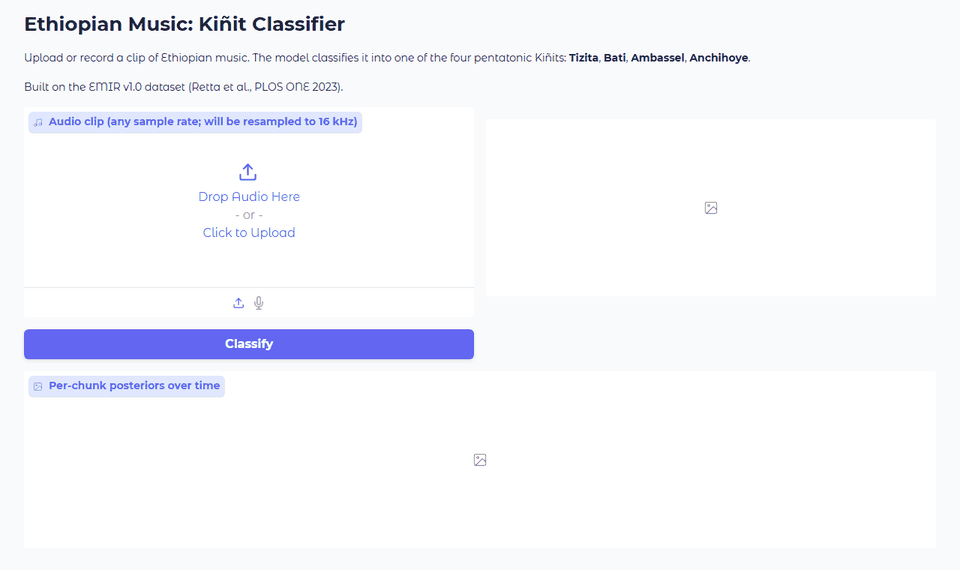

# Kiñit Classification of Ethiopian Music on EMIR

Code, results and a demo web app for recognising the Kiñit, the pentatonic mode, of Ethiopian music recordings. The four classes are Tizita, Bati, Ambassel and Anchihoye, and the data are the 600 recordings of the EMIR v1.0 corpus (Retta et al., 2023). Seven configurations are compared: EfficientNet-B0 and EfficientNet-B2 on log-mel spectrograms, the Audio Spectrogram Transformer, HuBERT, wav2vec 2.0, and a reproduction of the original EKM network on MFCCs and on log-mel spectrograms, each trained with three seeds.

The repository also contains a duplicate audit of EMIR. Landmark audio fingerprinting of all 179,700 file pairs places 398 of the 600 files in 126 groups of identical or resampled copies (332 files are byte-identical copies in 116 groups), which leaves 328 distinct recordings. Under a recording-level split, 79 of the 120 test recordings have a copy in training or validation, so every model is also scored on the 41 duplicate-free test recordings.

## Demo



The web app in `web/app.py` classifies an uploaded or recorded clip with a trained EfficientNet-B0 and shows the class probabilities and the posteriors of each 3-s segment. The clip in the recording is a test recording that has no copy in the training data.

## Results

Clip-level test accuracy (%) under the recording-level stratified 70/10/20 split in `results/split_paper.json`, as the mean ± sample standard deviation over seeds 1234, 2024 and 7777. The 95% interval is a bootstrap interval of the three-seed mean on duplicate-free recordings.

| Model | Parameters | All 120 test recordings | 79 with a copy in training or validation | 41 duplicate-free | 95% CI, duplicate-free |
|---|---:|---:|---:|---:|---:|
| EfficientNet-B0, three-seed ensemble | 3 x 4.0M | 90.00 | 98.73 | 73.17 | |
| EfficientNet-B0 | 4.0M | 88.61 ± 1.27 | 98.73 | 69.11 ± 3.73 | 56.1 to 81.3 |
| EfficientNet-B2 | 7.7M | 87.22 ± 0.96 | 99.58 | 63.41 ± 4.22 | 51.2 to 74.8 |
| Audio Spectrogram Transformer | 86.2M | 85.56 ± 2.10 | 100.00 | 57.72 ± 6.14 | 43.9 to 70.7 |
| wav2vec 2.0 | 90.2M* | 85.28 ± 2.68 | 99.58 | 57.72 ± 7.45 | 45.5 to 69.9 |
| HuBERT | 90.2M* | 84.44 ± 1.92 | 99.58 | 55.28 ± 5.08 | 41.5 to 68.3 |
| EKM reproduction, log-mel | 225k | 81.39 ± 0.96 | 93.67 | 57.72 ± 3.73 | 44.7 to 70.7 |
| EKM reproduction, MFCC | 225k | 79.72 ± 2.55 | 94.09 | 52.03 ± 3.73 | 39.0 to 65.0 |

\* Trainable parameters; the convolutional feature encoder is frozen.

Accuracy on all 120 test recordings is inflated by the 79 recordings that have a copy in training or validation, on which every model scores between 93 and 100%. The duplicate-free column is the fair comparison between models. In five-fold cross-validation (seed 1234), EfficientNet-B0 reaches 83.3% and the EKM-MFCC reproduction 77.3% over all 600 files, and 61.8% (95% CI 55.3 to 68.2) and 48.4% (41.9 to 55.3) on the 217 out-of-fold recordings with no copy in their training folds. Scored on all 600 files, training files included, the EKM-MFCC reproduction reaches 93.9%, close to the 95.0% published for EKM.

Every number above is read from `results/revision/paper_numbers.json`, which `scripts/revision/assemble.py` builds from the per-run results. The duplicate groups are listed by file name in `results/revision/duplicates.json`, so that future splits of EMIR can keep all copies of a recording on one side.

## Repository layout

```
src/               preprocessing, datasets and splits, models, training (train.py), evaluation (eval.py), inference
configs/           one YAML file per configuration, plus the five-fold variants
scripts/           EDA, pretrained-weight download, five-fold and ensemble runners
scripts/revision/  duplicate audit, re-scoring of stored models, statistics, pitch-class baselines
slurm/             SLURM batch script for each stage
web/               Gradio web app
results/           per-run metrics with per-recording predictions, split files, manifest
results/revision/  fingerprint and duplicate results, statistics, paper_numbers.json
docs/demo.gif      recording of the web app
```

## Reproducing the experiments

The EMIR audio is not included. Clone this repository and the corpus into its root, then install the dependencies (PyTorch 2.3.1 with CUDA 12.1 wheels was used):

```
git clone https://github.com/boaztulu/Ethio-Kinit-Classification.git
cd Ethio-Kinit-Classification
git clone https://github.com/Ethio2021/EMIR_Dataset_V1.git
pip install torch==2.3.1 torchaudio==2.3.1
pip install -r requirements.txt
```

Preprocess the corpus into 3-s segments, train a configuration, and evaluate it on the test recordings:

```
python -m src.data.preprocess --manifest results/manifest.json --cache_dir cache --win_sec 3.0 --overlap 0.5 --target_sr 16000 --top_db 30 --n_mels 128
python -m src.train --config configs/effnet_b0_mel.yaml --seed 1234
python -m src.eval --checkpoint checkpoints/effnet_b0_mel_s1234/best.pt --manifest results/manifest.json --index cache/index.json --split results/split_paper.json --out_dir results/effnet_b0_mel_s1234/eval
python scripts/run_kfold.py --config configs/effnet_b0_mel.yaml --manifest results/manifest.json --n_splits 5 --seed 1234
```

The scripts in `slurm/` run the same stages on a SLURM cluster; replace the account, QOS and e-mail placeholders and the partition names with those of your cluster. The duplicate-aware analysis re-scores the trained models without retraining them, in the order `scripts/revision/fingerprint.py`, `duplicates.py`, `eval_sets.py`, `pitch_profiles.py`, `stats.py` and `assemble.py`; the docstring of each script gives its arguments. `degrade.py` and `results/revision/degradation*` belong to an exploratory analysis of realistic degradations that was not completed for every model and is not part of the results above.

To run the web app on a trained checkpoint (the app was written for Gradio 4):

```
pip install "gradio>=4.40,<5"
python -m web.app --checkpoint checkpoints/effnet_b0_mel_s1234/best.pt --server_name 127.0.0.1
```

## Data and licence

The code and the result files are released under the MIT Licence. The EMIR recordings belong to their creators and are not redistributed here; the result files identify recordings only by their EMIR file names. If you use the corpus, please cite:

E. A. Retta et al., "Kiñit classification in Ethiopian chants, Azmaris and modern music: A new dataset and CNN benchmark," PLOS ONE, vol. 18, no. 4, e0284560, 2023. https://doi.org/10.1371/journal.pone.0284560
